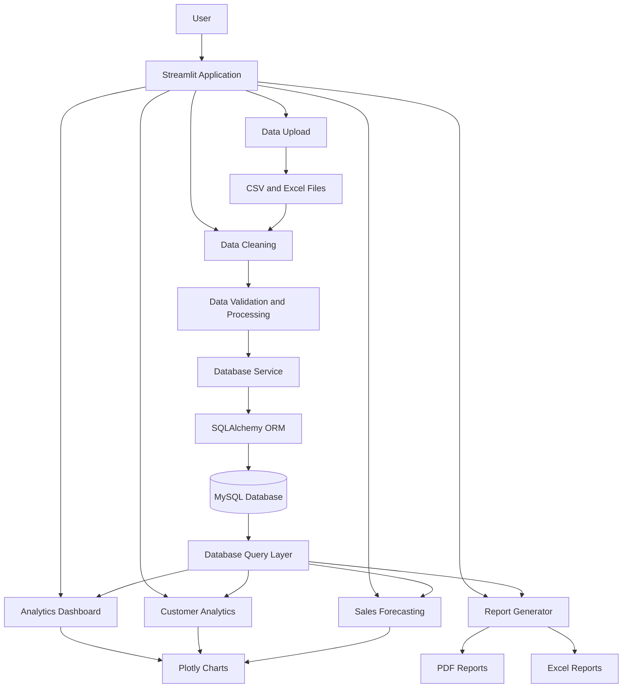
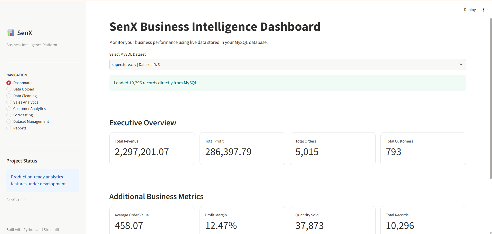
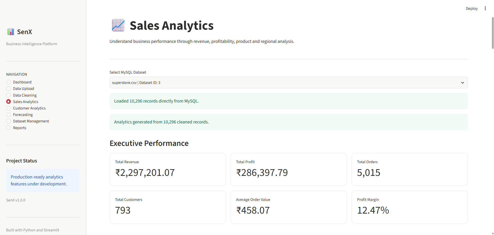
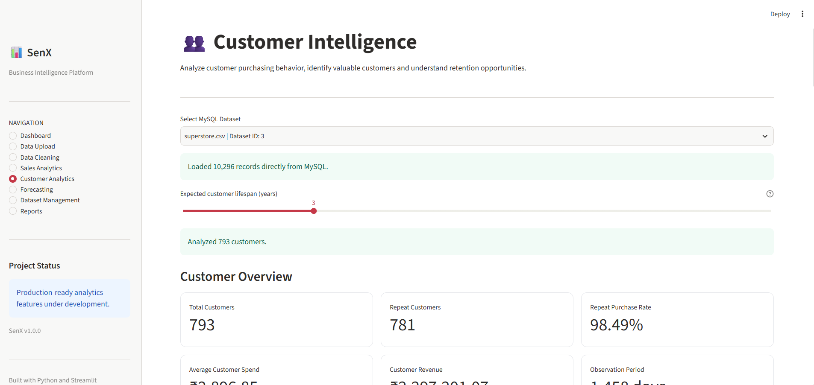
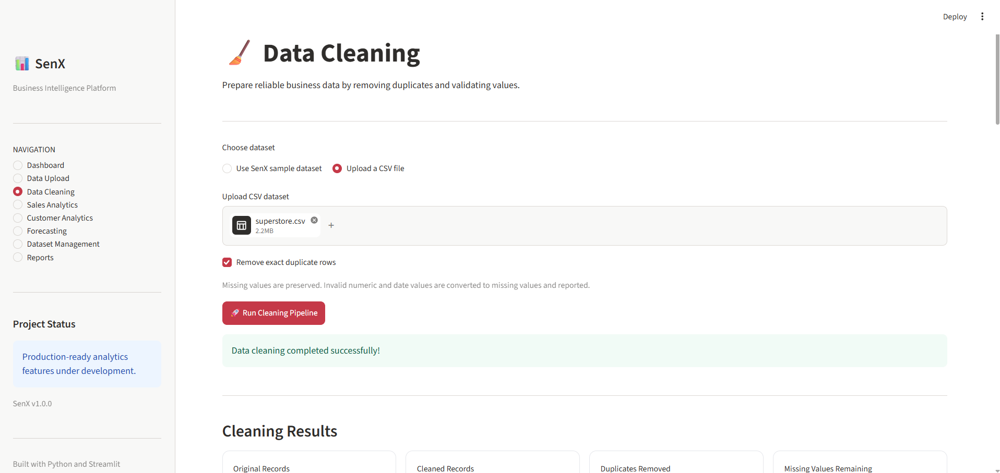
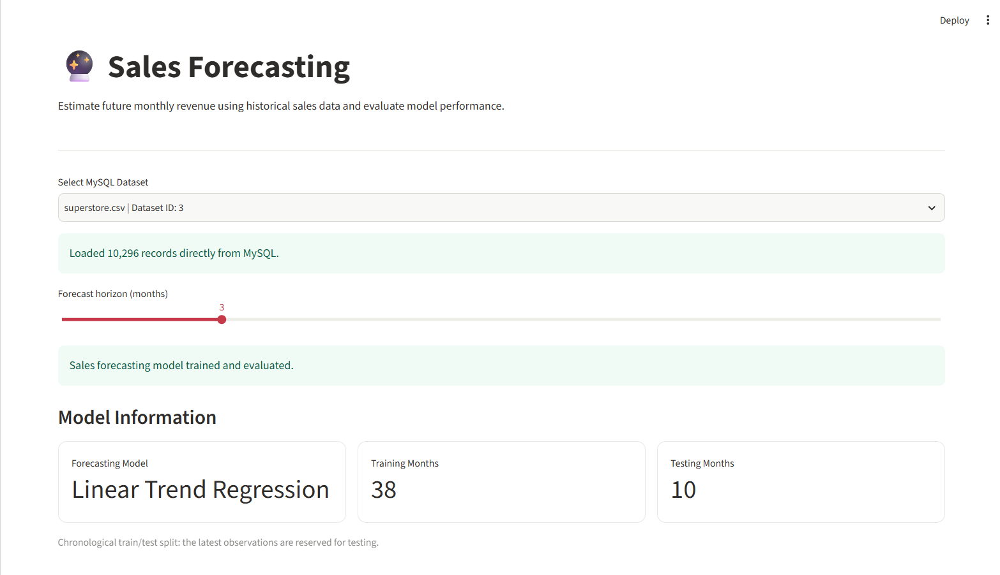
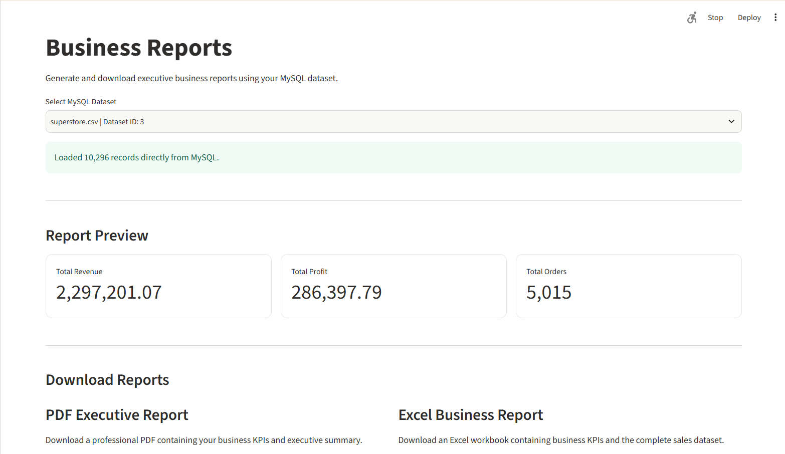

# SenX — Business Intelligence & Analytics Platform

**SenX** is a Python-based Business Intelligence and Analytics Platform designed to transform raw business data into meaningful insights through data cleaning, sales analytics, customer segmentation, forecasting and automated reporting.

The platform allows users to upload business datasets, process and validate data, store records in a MySQL database, explore interactive dashboards and generate downloadable business reports.
# Live application: senx-platform.onrender.com
## Key Features

### 1. Executive Dashboard
- Total revenue and profit analysis
- Total orders and customers
- Average order value
- Profit margin
- Business performance overview

### 2. Data Upload & Quality Analysis
- Upload CSV and Excel datasets
- Load sample business datasets
- Analyze missing values and duplicate records
- Generate dataset quality summaries
- Preview uploaded records

### 3. Data Cleaning
- Remove duplicate records
- Normalize missing values
- Validate numerical and date fields
- Export cleaned datasets
- Import cleaned datasets into MySQL

### 4. Sales Analytics
- Monthly revenue trends
- Category-wise sales analysis
- Regional performance analysis
- Top-performing products
- Profitability insights

### 5. Customer Analytics
- RFM (Recency, Frequency, Monetary) analysis
- Customer segmentation
- Customer purchase behaviour
- Average customer order value
- Estimated customer lifetime value

### 6. Predictive Analytics
- Monthly sales forecasting
- Historical versus predicted sales comparison
- Baseline model comparison
- Forecast accuracy evaluation using MAE, RMSE and MAPE

### 7. Database Management
- MySQL database integration
- SQLAlchemy ORM
- Dataset import and management
- Batch record insertion
- SHA-256 content-based duplicate detection
- Dataset deletion and record management

### 8. Automated Reporting
- Downloadable PDF business reports
- Excel reports with executive summaries
- Exportable cleaned datasets
- CSV exports for analytics

## Technology Stack

| Category | Technologies |
|---|---|
| Programming Language | Python 3.12 |
| Frontend / Dashboard | Streamlit |
| Data Processing | Python Standard Library |
| Data Visualization | Plotly |
| Database | MySQL 8 |
| ORM | SQLAlchemy |
| Database Driver | PyMySQL |
| Excel Processing | OpenPyXL |
| Machine Learning | Scikit-learn |
| PDF Generation | ReportLab |
| Testing | Pytest |
| Configuration | Python-dotenv |

## Project Structure

```text
SenX/
│
├── app.py
├── config.py
├── requirements.txt
├── .env.example
├── .gitignore
│
├── database/
│   ├── connection.py
│   └── models.py
│
├── modules/
│   ├── data_loader.py
│   ├── data_cleaner.py
│   ├── analytics.py
│   ├── customer_analysis.py
│   ├── forecasting.py
│   ├── database_service.py
│   ├── database_queries.py
│   └── report_generator.py
│
├── data/
│   ├── raw/
│   └── processed/
│
├── tests/
│
├── docs/
└── screenshots/
```

## Installation & Setup

### Prerequisites

- Python 3.12
- MySQL Server 8.0 or compatible version
- Git

### 1. Clone the repository

```bash
git clone https://github.com/Sagnik194/SenX.git
cd SenX
```

### 2. Create a virtual environment

```bash
python -m venv .venv
```

Activate it on Windows:

```powershell
.venv\Scripts\Activate.ps1
```

### 3. Install dependencies

```bash
python -m pip install -r requirements.txt
```

### 4. Configure MySQL

Create the database:

```sql
CREATE DATABASE senx_db
CHARACTER SET utf8mb4
COLLATE utf8mb4_unicode_ci;
```

Create a dedicated database user and grant access to `senx_db`.

### 5. Configure environment variables

Create a `.env` file in the project root using `.env.example` as a template.

Configure your own database credentials:

```env
DB_HOST=localhost
DB_PORT=3306
DB_NAME=senx_db
DB_USER=senx_app
DB_PASSWORD=your_mysql_password
```

**Never commit your actual `.env` file or database credentials to GitHub.**

### 6. Create database tables

```bash
python create_tables.py
```

### 7. Launch SenX

```bash
python -m streamlit run app.py
```

Open the local URL displayed in your terminal.

## Running Tests

Run the complete automated test suite:

```bash
python -m pytest -v
```

The current development test suite contains **40 passing tests** covering data loading, data cleaning, analytics, customer analysis, forecasting, database import operations and report generation.

## Database & Data Integrity

SenX uses MySQL to persist uploaded datasets and sales records.

Each newly imported dataset receives a SHA-256 content fingerprint to identify identical dataset content independently of its filename.

Dataset records are stored using SQLAlchemy ORM, with batch insertion to support larger imports.

## Current Project Status

- Core analytics modules: Completed
- CSV and Excel processing: Completed
- MySQL integration: Completed
- Interactive dashboards: Completed
- Customer segmentation: Completed
- Sales forecasting: Completed
- PDF and Excel reporting: Completed
- Automated tests: 40 passing
- UI refinement and documentation: In progress
- Deployment: Planned

## Future Enhancements

- Advanced forecasting with seasonal models
- Automated customer churn prediction
- Role-based authentication and user management
- Advanced interactive filtering
- Cloud deployment
- Expanded business intelligence KPIs

---

---


## System Architecture




## Application Screenshots

### 1. Executive Dashboard


### 2. Sales Analytics


### 3. Customer Analytics


### 4. Data Cleaning


### 5. Sales Forecasting


### 6. Business Reports


## Author

**Sagnik Sen**

B.Tech — Information Technology  
Guru Nanak Institute of Technology, Kolkata

GitHub: [Sagnik194](https://github.com/Sagnik194)

---

*SenX — Turning Business Data into Actionable Insights.*
